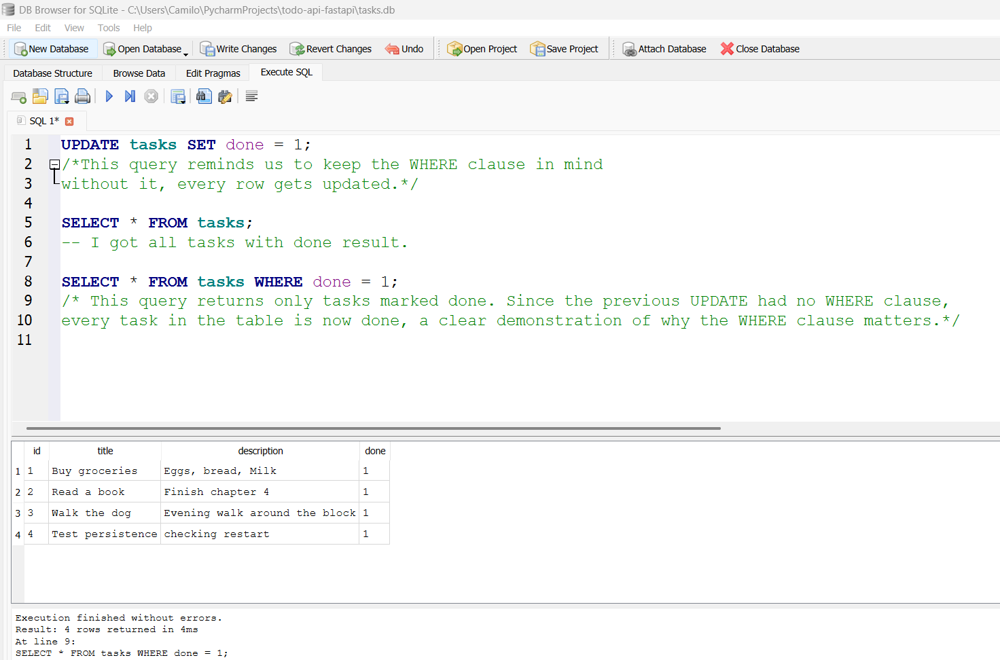
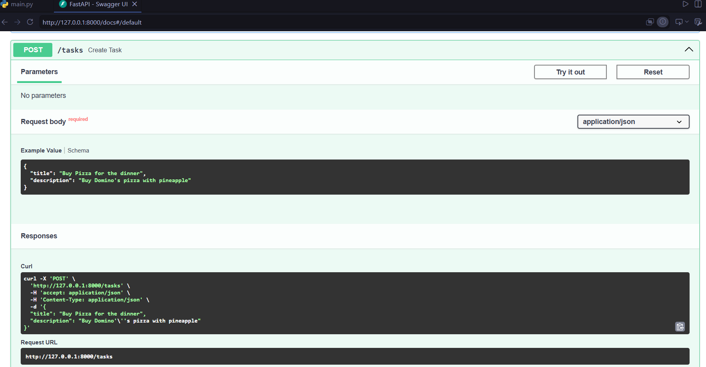
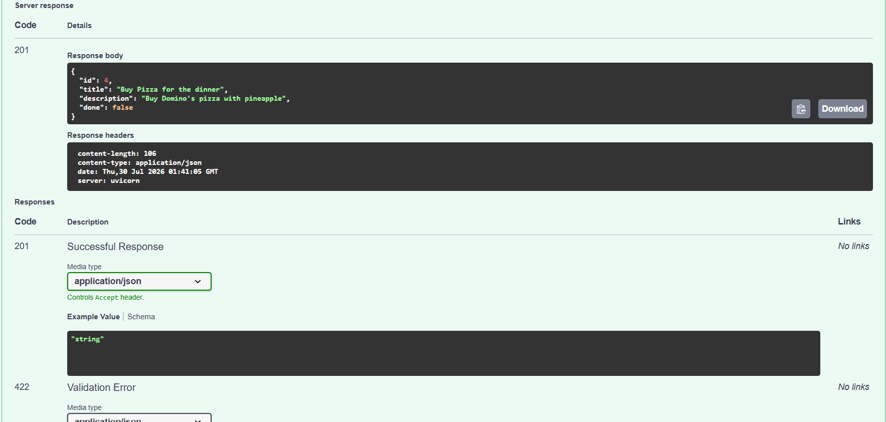

# Todo API

A CRUD API for managing tasks, built with FastAPI and SQLite as part of the FlyRank AI Backend Internship (Weeks 2–3). Tasks are stored in a SQLite database, so they survive server restarts.

## Installation & Running

```bash
git clone https://github.com/Carb18/todo-api-fastapi.git
cd todo-api-fastapi
python -m venv venv
source venv/Scripts/activate  # Windows Git Bash
pip install -r requirements.txt
uvicorn main:app --reload
```

Then open http://localhost:8000/docs to see the interactive Swagger UI.

On first run the app creates `tasks.db`, the `tasks` table, and three example tasks automatically. No manual setup is needed.

## Why SQLite

SQLite keeps the whole database in a single file, needs no separate server, and persists data across restarts. That fits a small single-process API like this one. For many concurrent writers I would move to PostgreSQL, since SQLite allows only one writer at a time (I ran into this lock when DB Browser and the API wrote to the same file).

## Database

- File: `tasks.db`, created automatically and git-ignored, so every clone starts fresh.
- Schema: `id` (INTEGER PRIMARY KEY AUTOINCREMENT), `title` (TEXT), `description` (TEXT), `done` (BOOLEAN, stored as 0/1).
- Seeding: three example tasks are inserted only when the table is empty, so restarting never duplicates them.
- All queries are parameterized (`?` placeholders), never built by string concatenation.
- Storage code lives in `database.py`. The routes in `main.py` only call its functions.

## Endpoints

| Method | Path         | Description         |
|--------|--------------|----------------------|
| GET    | /            | API info             |
| GET    | /health      | Health check         |
| GET    | /tasks       | List all tasks       |
| GET    | /tasks/{id}  | Get one task         |
| POST   | /tasks       | Create a new task    |
| PUT    | /tasks/{id}  | Update a task        |
| DELETE | /tasks/{id}  | Delete a task        |

## Example request

**Create a task:**
```bash
curl -i -X POST http://localhost:8000/tasks -H "Content-Type: application/json" -d "{\"title\":\"Test task\",\"description\":\"testing\"}"
```

**Response:**
```
<paste your real curl output here>
```

## Exploring the database by hand

I opened `tasks.db` in DB Browser for SQLite and ran SQL directly against it.



```sql
SELECT * FROM tasks WHERE done = 1;
```

After running `UPDATE tasks SET done = 1;` (deliberately without a `WHERE` clause), this query returned every task in the table, all marked as done. The API reflected the same change without a server restart, because both tools read the same file.

## Swagger UI


